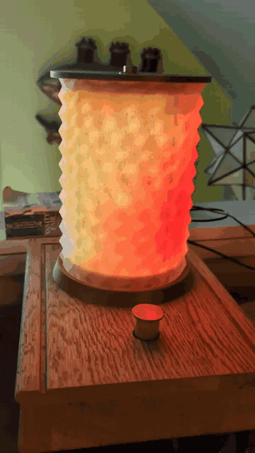

# Collection of Arduino projects
## dancefloor
Basic rainbow demo for dancefloor sub-lighting.

## dining_light
Complicated system of menus to fine-tune whole-room lighting

## flame
Version 1 of the flame lamp demo, without the solid mode. Obsolete in favor of kite_lamp.

## kite_lamp
Version 2 of the flame lamp, with solid mode and various other improvements. Now the main avenue of development.\

## led_chandelier
A dreamy slow-fading demo made for a particular chandelier made from a hoop and six lanterns.

## rig_light
Basic solid color mood light with rotary encoder support for hue, saturation, and value settings.
